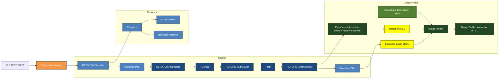

[](https://github.com/giis-uniovi/retorch/actions/workflows/test.yml)
[](https://sonarcloud.io/summary/new_code?id=my%3Aretorch)
[](https://central.sonatype.com/artifact/io.github.giis-uniovi/retorch-annotations)

# RETORCH: Resource-aware End-to-End Test Orchestration

This repository contains a series of components of the RETORCH End-to-End (E2E) test orchestration framework. It's
primary goal is to optimize E2E test execution by reducing both the execution time and the number of unnecessary
Resource[^1] redeployment's.

NOTE: The repository is a work in progress, the initial version only made available the annotations, and currently we're
migrating the orchestration generator module. Additional components will be added in future releases.

[^1]: Henceforth, we will use the term "Resources" (capitalized) when referring to the ones required by the E2E test
suite.

## Contents

- [RETORCH: Resource-aware End-to-End Test Orchestration:]()
  - [Quick Start](#quick-start)
  - [RETORCH Framework Model](#retorch-framework-model)
  - [RETORCH Annotations](#retorch-annotations)
  - [RETORCH Orchestration](#retorch-orchestration)
  - [RETORCH Usage Profile](#retorch-usage-profile)
  - [Contributing](#contributing)
  - [Contact](#contact)
  - [Citing this work](#citing-this-work)
  - [Acknowledgments](#acknowledgments)

## Quick-start

- Add the dependencies [
  `io.github.giis-uniovi:retorch-annotations`](https://central.sonatype.com/artifact/io.github.giis-uniovi/retorch-annotations)
  and [
  `io.github.giis-uniovi.retorch-orchestration`](https://central.sonatype.com/artifact/io.github.giis-uniovi/retorch-orchestration)
  to the `pom.xml` of your SUT.
- Add the annotations to the test classes as indicated below.
- Configure the E2E test suite as indicated below.
- Run the orchestration generator standalone JAR to generate the pipelining-scripting code.
- (Optional) Enable the [usage profile](#retorch-usage-profile) to measure the resources used by the execution and
  compare what it would cost in different clouds.
- Commit and push the generated files to Git.

## RETORCH Framework Model

The diagram below shows the RETORCH data flow: the test annotations, the orchestration model, and the usage
profile obtained from the measurements of an execution.



## RETORCH Annotations

The RETORCH framework provides a set of custom annotations to define and manage Resources used in end-to-end testing.
These annotations allow testers to group, schedule, and characterize Resources. To execute test cases using RETORCH,
each test case must be annotated with at least one `@AccessMode`, and which refers to an already defined Resouce in the
`<SUT_NAME>SystemResources.json` file. Additional information about the `<SUT_NAME>SystemResources.json` can be found
in [RETORCH Orchestration](#retorch-orchestration).

The tester needs to specify the access mode using the following attributes:

- `resID`: Resource identifier for the access mode.
- `concurrency`: The upper bound of test cases that can access the resource concurrently.
- `sharing`: Allows sharing the resource between multiple test cases.
- `accessMode`: The type of access mode performed by the test case.

```java
@AccessMode(resID = "LoginService", concurrency = 10, sharing = true, accessMode = "READONLY")
```

The following code snippets illustrate a test case annotated with multiple `@AccessMode` annotations each one
corresponding to a different Resource:

```java

@AccessMode(resID = "LoginService", concurrency = 10, sharing = true, accessMode = "READONLY")
@AccessMode(resID = "OpenVidu", concurrency = 10, sharing = true, accessMode = "NOACCESS")
@AccessMode(resID = "Course", concurrency = 10, sharing = true, accessMode = "READONLY")
@ParameterizedTest
@MethodSource("data")
void forumLoadEntriesTest(String usermail, String password, String role) {
  this.user = setupBrowser("chrome", TJOB_NAME + "_" + TEST_NAME, usermail, WAIT_SECONDS);
  driver = user.getDriver();
  this.slowLogin(user, usermail, password);
}
```

## RETORCH Orchestration

The RETORCH framework provides a generator that creates the Execution Plan, along with the required pipelining and
script files for execution in a CI environment. The generation of scripts and pipelining code is based on the Access
Modes annotated within the test cases and the Resource information specified in
`.retorch/configurations/<SUT_NAME>SystemResources.json`.

The RETORCH orchestration generator requires 4 inputs:

- The annotated E2E test cases with the [RETORCH access modes](#retorch-annotations) into a **single module** Maven
  project.
- A file with the Resources in JSON format(`<SUT_NAME>SystemResources.json`).
- A properties file (`retorchCI.properties`)  with the Environment configuration.
- A custom `docker-compose.yml` file.

Given these inputs, the generator gives as output the necessary scripting code and the `Jenkinsfile` to execute the E2E
test suite into a Continuous Integration system.

### Prepare the E2E Test suite

The first step is to create several folders to store the configurations and place the `docker-compose.yml`
in the single module project root. The resulting directory tree might look like as:

```
.

├── 📁 .retorch/
│   ├── 📁 configurations/
│   └── 📁 customscriptscode/
├── 📦 src
├── 🐳 docker-compose.yml

```

- The `📁 .retorch/` directory would contain all the configuration files and scripting snippets that would be used to
  generate the pipelining code and the scripts to set up, deploy, and tear down the different Resources and TJob.
  Contains two subdirectories:
  - `📁 configurations/`: stores the Resources and CI configuration files.
  - `📁 customscriptscode/`: stores the different script snippets for the tear down, set up and environment.
- The `docker-compose.yml` in the root of the project.
- The different project directories and files.

The following subsections explain how to create each configuration file and how to prepare the `docker-compose.yml`file.

#### Create the Resource JSON file

The Resource file must be placed in the `.retorch/configurations/` and named with the system or test suite name,
followed by `SystemResources.json` (`<SUT_NAME>SystemResources.json`). This file contains a map with a series of
Resources, using their unique ResourceID as a key.
For each Resource the tester needs to specify the following attributes:

- `resourceID`: A unique identifier for the Resource.
- `replaceable`: A list of Resources that can replace the current one.
- `hierarchyParent`: A resourceID of the hierarchical parent of the Resource.
- `elasticityModel`: The elasticity model of the Resource, is composed by the following attributes:
  - `elasticityID`: A unique identifier for the elasticity model.
  - `elasticity`: Integer with the available Resources.
  - `elasticityCost`: Instantiation cost of each Resource.
- `resourceType`:  String with the type of the Resource(e.g. LOGICAL, PHYSICAL or COMPUTATIONAL).
- `dockerImage`: String with the concatenation of the placeholder name in the docker-compose, using `;` as separator
  between placeholder and the image name.

The Resources do not need to declare the capacities (memory, processor, storage) they require: the usage of each
execution is measured by the pipeline (see [RETORCH Usage Profile](#retorch-usage-profile)). Files that still declare
`minimalCapacities` keep working, the value is ignored.

The following snippet shows an example of two Resources declared in the JSON file:

```json
{
  "userservice": {
    "hierarchyParent": [
      "mysql"
    ],
    "replaceable": [],
    "elasticityModel": {
      "elasticityID": "elasmodeluserservice",
      "elasticity": 5,
      "elasticityCost": 30.0
    },
    "resourceType": "LOGICAL",
    "resourceID": "userservice",
    "dockerImage": "userservice;wigo4it/identityserver4:latest"
  },
  "frontend": {
    "hierarchyParent": [],
    "replaceable": [],
    "elasticityModel": {
      "elasticityID": "elasmodelfrontend",
      "elasticity": 1,
      "elasticityCost": 300.0
    },
    "resourceType": "LOGICAL",
    "resourceID": "frontend",
    "dockerImage": "frontend;nginx:latest"
  }
}
```

#### Create the retorchCI.properties file

The CI file must be placed in `.retorch/configurations/`, namely `retorchCI.properties` containing several
parameters related to the SUT and the Continuous Integration Infrastructure, these parameters are the following:

- `agentCIName`: the specific Jenkins agent used to execute the test suite.
- `sut-wait-html`: state in the frontend (HTML displayed) when the SUT is ready to execute the test suite.
- `sut-location`: location of the `docker-compose.yml` file used to deploy the SUT.
- `app-url`: the URL where the frontend of the web application is made available.
- `testsBasePath`: Path to the Java project root.

The following parameters are optional and only matter for the [usage profile](#retorch-usage-profile):

- `profiling`: `true` adds the measurement of the resources and the usage profile to the pipeline (default `false`).
  The `--profiling` / `--no-profiling` option of the generator overrides it.
- `azure-region`, `aws-region`: cloud regions whose prices are compared, as comma separated lists (e.g.
  `westeurope,northeurope`); defaults `westeurope` and `eu-west-1`; an empty value disables that provider. The
  pipeline can override them with the `AZURE_REGIONS` / `AWS_REGIONS` environment variables.
- `profiling-jar-url`: where the pipeline downloads the profiling tool (`retorch-profiling-cli.jar`) from the first time
  (default: the latest GitHub release).  A project can prepare the jar itself in the optional
  `custom-usageprofile` snippet (see below).

The following snippet provides an example of how this file looks like:

```properties
agentCIName=any
sut-wait-html=<title>Hello World</title>
sut-location=$WORKSPACE
app-url=https://full-teaching-$TJOB_NAME:5000
testsBasePath=./
profiling=true
azure-region=westeurope
aws-region=eu-west-1
```

#### Preparing the docker-compose.yml file

The orchestration generator also requires to parametrize the `docker-compose.yml` used to deploy the application by
means including the necessary environment variables in the containers names and URIs, as well as the placeholders of the
images specified above.
Examples of the necessary changes in the `docker-compose.yml` can consulted in the FullTeaching and eShopOnContainers
repositories:

- FullTeaching:
  - [Original
    `docker-compose.yml`](https://github.com/elastest/full-teaching/blob/master/application/docker-compose/docker-compose.yml)
  - [RETORCH
    `docker-compose.yml`](https://github.com/giis-uniovi/retorch-st-fullteaching/blob/main/docker-compose.yml)
- EshopContainers:
  - [Original `docker-compose.yml`](https://github.com/erjain/eShopOnContainers/blob/dev/src/docker-compose.yml) and [
    `docker-compose.prod.yml`](https://github.com/erjain/eShopOnContainers/blob/dev/src/docker-compose.prod.yml)
  - [RETORCH
    `docker-compose.yml`](https://github.com/giis-uniovi/retorch-st-eShopContainers/blob/main/sut/src/docker-compose.yml)

#### (Optional) Specify script snippets to include in the set-up tear-down and environment

The RETORCH orchestration generator allows to specify scripting code/commands to be included in the generated set up,
tear down, and the environment declaration of each TJob. To include it, the tester must create the following files in
`.retorch/customscriptscode`:

- `custom-tjob-setup`: Contains the custom set up code (e.g. declare some environment variable specific for each TJob)
  or custom logging systems. It runs before the containers of the TJob are deployed.
- `custom-tjob-teardown`: Contains the custom tear down code (e.g. dump the coverage of the SUT or save some generated
  outputs). It runs **before** the containers of the TJob are removed, so they are still running.
- `custom.env`: Contains configurations and environment variables common to all TJobs.
- `custom-coi-setup`: Contains the custom set up code for the cloud or on-premise infrastructure (e.g. clone a
  repository and made it available for all TJobs).
- `custom-coi-teardown`: Contains the custom tear-down code for the cloud or on-premise infrastructure (e.g. calculate
  the coverage report or clean certain aspects of the environment). It is inserted in a script, so it must not `exit`.
- `custom-jenkins-post`: Contains Jenkins steps that are inserted verbatim in the `post { always { } }` block of the
  `Jenkinsfile` (e.g. `publishHTML` or `archiveArtifacts` of the coverage report).
- `custom-usageprofile`: Only with the usage profile: shell code run by `generateusageprofile.sh` before it looks for the
  profiling jar, to prepare the jar by other means (e.g. build it from source while no release publishes it).

Examples of the snippets files can be consulted
in [FullTeaching Test Suite](https://github.com/giis-uniovi/retorch-st-fullteaching)
and [eShopOnContainers](https://github.com/giis-uniovi/retorch-st-eShopContainers).

Once created the different properties and configuration files, the single module directory tree might look like:

```
.
├── 📁 .retorch/
│   ├── 📁 configurations/
│   │   ├── {} <SUT_NAME>SystemResource.json
│   │   └── ⚙️ retorchCI.properties
│   └── 📁 customscriptscode/
│       ├── 📄 custom-tjob-setup
│       ├── 📄 custom-tjob-teardown
│       ├── 📄 custom-coi-setup
│       ├── 📄 custom-coi-teardown
│       ├── 📄 custom-jenkins-post
│       ├── 📄 custom-usageprofile
│       └── 🔐 custom.env
├── 📦 src
├── 🐳 docker-compose.yml
```

### Executing the Orchestration generator

Once all the files are created and the `docker-compose.yml` is prepared, follow these steps from the
**root of the SUT project** (the same directory that contains `.retorch/`).

#### Step 1 — Compile the test classes and copy dependencies

The generator loads the annotated test classes at runtime using the Java ClassLoader, so they must be compiled
and their transitive dependencies must be available before running the JAR.
Run the following Maven command from the project root:

```bash
mvn test-compile dependency:copy-dependencies -DincludeScope=test
```

This compiles the test sources into `target/` and copies all test-scoped dependency JARs into
`target/dependency/` (or the equivalent subdirectory if your project overrides `outputDirectory`).

#### Step 2 — Run the standalone JAR

```bash
java -jar retorch-orchestration-<version>-standalone.jar <rootPackageNameTests> <systemName> <jenkinsFilePath> [--profiling|--no-profiling]
```

The JAR is available in [Maven Central](https://central.sonatype.com/artifact/io.github.giis-uniovi/retorch-orchestration)
with the `standalone` classifier. The arguments are:

- `rootPackageNameTests`: root package where the annotated E2E test classes are located
  (e.g. `com.sutexample.functional.tests`).
- `systemName`: system name that must match the name used in
  the [Resources JSON file](#create-the-resource-json-file) (e.g. `sutexample`).
- `jenkinsFilePath`: directory path where the `Jenkinsfile` will be written (e.g. `./` for the project root).
- `--profiling` / `--no-profiling` (optional): add or not the measurement of the resources and the usage profile to the
  pipeline, overriding the `profiling` property of `retorchCI.properties`.

For example, for the [FullTeaching test suite](https://github.com/giis-uniovi/retorch-st-fullteaching):

```bash
mvn test-compile dependency:copy-dependencies -DincludeScope=test
java -jar retorch-orchestration-<version>-standalone.jar \
  com.fullteaching.e2e.no_elastest.functional.test \
  FullTeaching \
  ./
```

### RETORCH Orchestration generator outputs

The generator provides four different outputs: the pipelining code, the necessary scripts to set up, tear down and
execute the TJobs(`.retorch/scripts/tjoblifecycles`),
the infrastructure(`.retorch/scripts/coilifecycles`) and the different environment files of each TJob (
`.retorch/envfiles`) :

- `⛓️ Jenkinsfile`: located in the root of the project, contains the pipelining code with the different stages in
  sequential-parallel
  that perform the different TJob lifecycle stages.
- `📁 .retorch/scripts/tjoblifecycles` and `.retorch/scripts/coilifecycles` contains the set up, execution, and
  tear down scripts for the TJobs and infrastructure
- `📁 .retorch/envfiles`: contains the generated custom environment of each TJob.

With the [usage profile](#retorch-usage-profile) enabled it also generates the `Usage-Profile` stage of the
`Jenkinsfile`, the scripts `.retorch/scripts/resourcemonitor.sh` and `.retorch/scripts/generateusageprofile.sh`, and
`.retorch/executionplan.json` with the execution graph (TJobs, stages, dependencies and tests of each TJob).

## RETORCH Usage Profile

The usage profile shows how many resources an execution of the E2E test suite really used and what it would cost in
different cloud deployments. It is a **single self-contained HTML file** (data, scripts, styles, charts and logos are
inlined, no external requests) that is published by the pipeline and can be opened anywhere.

It is enabled with `profiling=true` in `retorchCI.properties` or with the `--profiling` option of the generator.
Without it the pipeline does not measure anything and has no `Usage-Profile` stage.

### What the pipeline does

1. When a TJob is set up, `resourcemonitor.sh` starts sampling (every 5 s, `RETORCH_MONITOR_INTERVAL`) the CPU, memory
   and disk of the containers of that TJob; it stops when the TJob is torn down. The start and end of every lifecycle
   phase (set-up, test execution, tear-down) are timestamped as before.
2. When the infrastructure is torn down, `resourcemonitor.sh export` writes the **single usage file**
   `artifacts/usageprofile-<branch>-<build>.csv`, with the columns
   `kind;tjobname;stage;item;start;end;cpu_percent;mem_bytes;disk_bytes;image;image_bytes;volume_bytes`. A `phase` row
   gives the start and end of a lifecycle phase of a TJob (the infrastructure phases belong to the TJob named `COI`); a
   `sample` row gives the CPU (percentage of one core), memory and writable-layer size (bytes) of a container at an
   instant; a `container` row, written the first time the container is seen, gives its image, the size of that image and
   the size of the volumes it mounts. The storage used therefore counts the images and the volumes, not only the
   writable layers.
3. The `Usage-Profile` stage runs `generateusageprofile.sh`, which builds the usage profile from that file and from
   `.retorch/executionplan.json`, and the `post` block publishes `artifacts/usageprofile/usageprofile.html` as the
   "RETORCH Usage Profile" report. A failure of this stage marks it unstable but never fails the build.

> **Temporary:** until a release publishes the profiling tool, the example projects prepare the jar in their
> `.retorch/customscriptscode/custom-usageprofile` snippet: it clones this repository, builds the profiling module with
> Maven (only when the branch has new commits) and leaves the jar where the script looks for it. The agent needs `git`,
> `mvn` and `java`. When a release exists, delete that file and the script downloads the released jar.

### What the profile shows

- The measured CPU, memory and disk of the execution over time (with zoom).
- **Alternatives and cost.** For every provider and region the cheapest virtual machines (up to three of different
  size) that fit the measured peak, and the managed container services (AWS Fargate, Azure Container Instances). A VM is
  billed while it is up: the cost of the capacity that is paid but not used is shown as **oversubscription**. Container
  services are pay-per-use, so they have none.
- **Cost breakdown** of the selected alternative by TJob, lifecycle phase and cloud object (compute and storage).
- **Scenario explorer.** Filter by provider, type and region; select several alternatives and compare them side by side
  by phase or by TJob; show or hide the oversubscription, switch between USD and percentage of the cheapest, and sort.
- **Execution graph.** Every TJob is a bar whose length is proportional to its duration, painted in three parts
  proportional to its set-up, test execution and tear-down time, with arrows for the dependencies. Clicking a bar shows
  the tests executed by that TJob, its resources, durations, peak CPU and memory, and its cost in the selected
  alternative.
- Spanish, English, French and German; light, dark or automatic theme; links such as
  `usageprofile.html#lang=es&theme=dark&node=tjobg` open the page in a given state.

Prices are fetched from the public price lists (Azure Retail Prices API and AWS Price List) and cached for 24 hours in
`$HOME/.retorch/prices.json`; the first download of the AWS EC2 list is large (hundreds of MB per region) and is parsed
in streaming. Google Cloud is not supported yet.

### Requirements in Jenkins

- The *HTML Publisher* plugin.
- The page uses JavaScript, which the default Content Security Policy of Jenkins blocks. To get the interactive page,
  relax it (`hudson.model.DirectoryBrowserSupport.CSP`) or download the HTML artifact and open it locally.

### Generate it by hand

The `retorch-profiling` module builds an executable JAR (`mvn package`, classifier `cli`):

```bash
java -jar retorch-profiling-<version>-cli.jar <planName> <usageCsv> <outputHtml> <azureRegions> <awsRegions> <priceCacheFile> [executionPlanJson]
```

- `usageCsv`: the usage file described above.
- `azureRegions`, `awsRegions`: comma separated regions (an empty string disables the provider).
- `priceCacheFile`: JSON file where the prices are cached.
- `executionPlanJson` (optional): `.retorch/executionplan.json`; without it the execution graph is not shown.

## Contributing

See the general contribution policies and guidelines for *giis-uniovi* at
[CONTRIBUTING.md](https://github.com/giis-uniovi/.github/blob/main/profile/CONTRIBUTING.md).

## Contact

[Cristian Augusto](https://www.augustocristian.es) - [augustocristian@uniovi.es](mailto:augustocristian@uniovi.es) -
[Software Engineering Research Group (GIIS) - University of Oviedo, ES](https://giis.uniovi.es)

## Citing this work

RETORCH E2E Test Orchestration framework:

- Cristian Augusto, Jesús Morán, Antonia Bertolino, Claudio de la Riva, and Javier Tuya,
  “RETORCH: an approach for resource-aware orchestration of end-to-end test cases,”
  *Software Quality Journal*, vol. 28, no. 3, 2020.
  https://doi.org/10.1007/s11219-020-09505-2 - [Full Article available](https://link.springer.com/article/10.1007/s11219-020-09505-2) - [Authors version](https://digibuo.uniovi.es/dspace/bitstream/handle/10651/55405/RETORCHSQJExtension_BUO.pdf;jsessionid=0E661594C8732B8D2CA53636A31E4FD5?sequence=1) -
  [Download citation](https://citation-needed.springer.com/v2/references/10.1007/s11219-020-09505-2?format=refman&flavour=citation)

RETORCH*: A Cost and Resource aware Model for E2E Testing in the Cloud:

- Cristian Augusto, Jesús Morán, Antonia Bertolino, Claudio de la Riva, and Javier Tuya,
  “RETORCH*: A Cost and Resource aware Model for E2E Testing in the Cloud”,
  *Journal of Systems and Software*, vol. 221 , pages. 112237, 2025.
  https://doi.org/10.1016/j.jss.2024.112237 - [Full Paper available](https://www.sciencedirect.com/science/article/pii/S0164121224002814?via%3Dihub) - [Authors version](https://hdl.handle.net/10651/75794) -
  [Download citation](https://www.sciencedirect.com/science/article/pii/S0164121224002814?via%3Dihub#:~:text=Export%20citation%20to%20text)

## Acknowledgments

This work has been developed under the TestBUS (PID2019-105455GB-C32) and project supported
by the [Ministry of Science and Innovation (SPAIN)](https://www.ciencia.gob.es/)

---

<p align="center">
  <a href="https://giis.uniovi.es/"></a>
</p>
